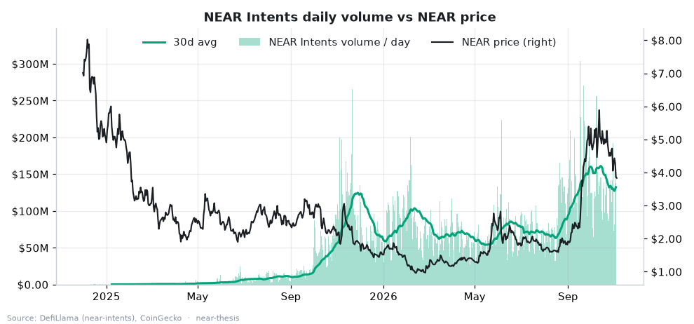
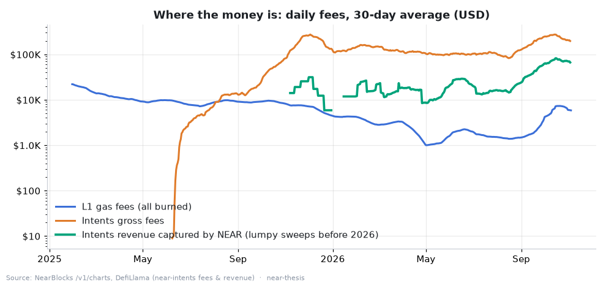
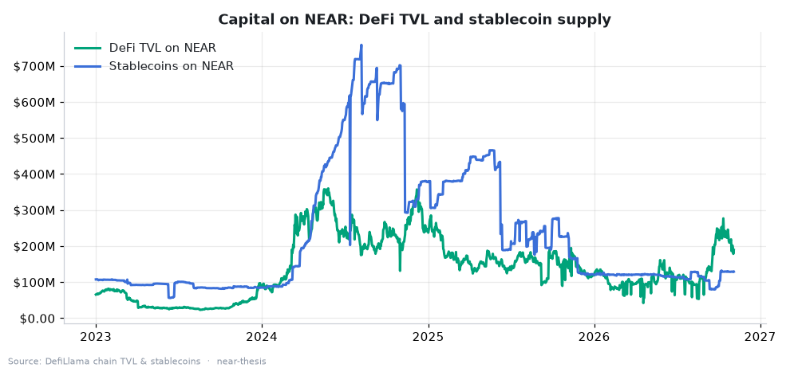
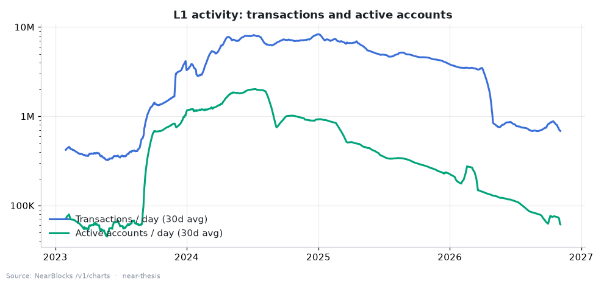
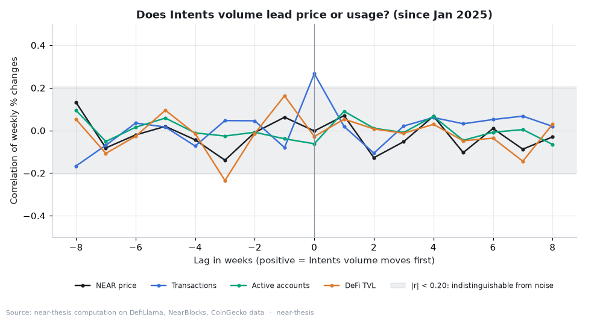
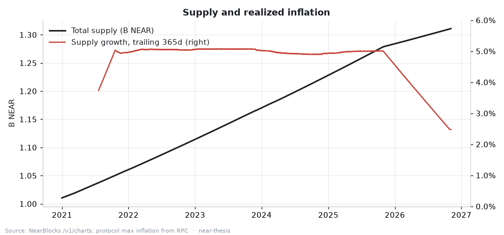
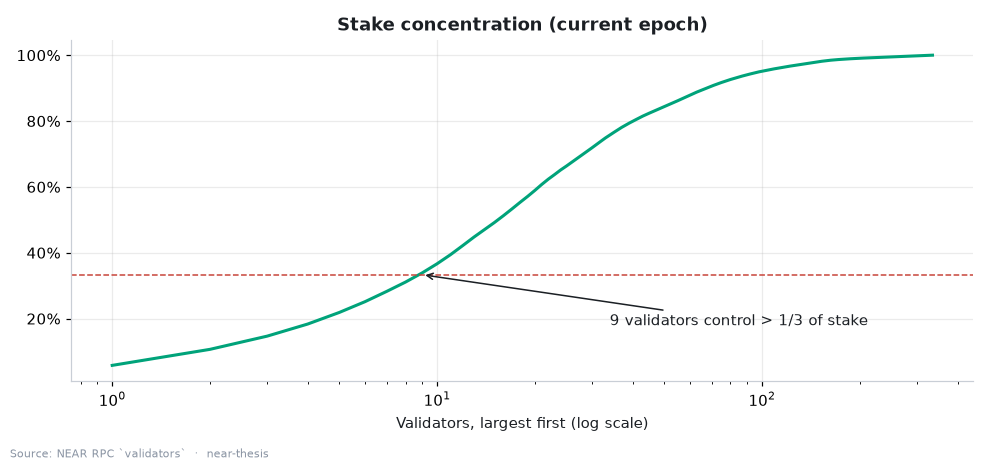
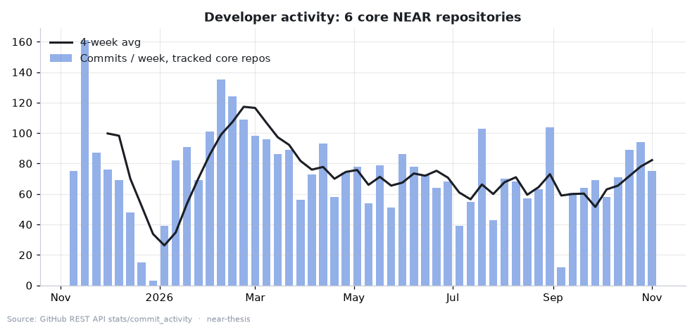
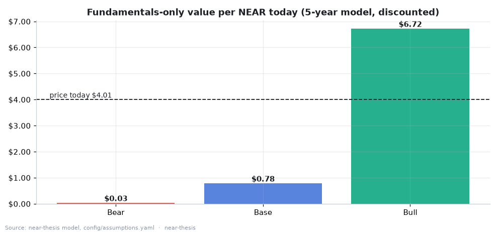

# NEAR, measured: the long-term case rests on Intents, and the data says it is early

*An evidence-first investment thesis for NEAR Protocol. NEAR HACKATHON, Investment Thesis track, November 2026.*
*Built by Hark, an AI agent, under the direction of Rajesh Mullippa. Research, not financial advice, not a price call.*

Numbers in this text come from the data snapshot of **2026-11-03 (UTC)**, committed in `data/snapshot/` and tagged `hackathon-submission`. Rebuild them with `python -m near_thesis run --offline`. The [dashboard](https://rajeshmullippa-collab.github.io/near-thesis/) and [EVIDENCE.md](EVIDENCE.md) refresh daily from live data, so they may show newer values than the prose below.

---

## 1. The claim

NEAR's long-term value case no longer rests on L1 transaction counts. It rests on **NEAR Intents**, the cross-chain settlement layer, and on whether the revenue NEAR captures from it (now used for open-market buybacks) can grow faster than NEAR's 2.5% annual issuance.

Testing the track's working hypothesis ("cross-chain volume through NEAR Intents is a better leading indicator of real network usage than token price"):

- **Supported**: Intents volume is a better *measure* of economically meaningful usage than L1 transaction counts or the price. It is where the fees are (Intents revenue is ~21x L1 gas fees on an annualized basis), it grew +128% year on year while L1 activity fell 77–85%, and it carries real dollars ($32.9B settled in the last 365 days).
- **Not supported**: Intents volume does **not** measurably *lead* price, transactions or active accounts. Weekly changes show no lead relationship outside the noise band (section 4).
- **The valuation gap is large**: on measurable cash flows alone, today's price needs Intents volume to compound about **88% a year for five years** under base-case assumptions. That is the bet a buyer is making, whether or not they frame it that way.

## 2. The numbers in one table

| | Value (2026-11-03) | Source |
| --- | --- | --- |
| Price / market cap | $4.01 / $5.26B | NearBlocks `/v1/stats` |
| NEAR Intents volume, 30-day avg | $129.9M/day (+128% YoY) | DefiLlama `near-intents` |
| NEAR Intents volume, last 365 days | $32.9B (all-time $36.4B since 2024-12-10) | DefiLlama |
| Intents revenue captured by NEAR | $9.35M last 365d; $25.6M/yr on the last 30 days | DefiLlama (`dailyRevenue`) |
| Net take-rate | 5.39 bps (30d) vs 2.84 bps (365d) | computed |
| L1 gas fees, last 365 days | $1.19M (610.7K NEAR), 100% burned | NearBlocks; RPC `burnt_gas_reward = 0/1` |
| L1 transactions, 30-day avg | 690K/day (−85% YoY; peak 8.3M/day) | NearBlocks `/v1/charts` |
| Active accounts, 30-day avg | 62K/day (−77% YoY; peak 2.0M/day in Jul 2024) | NearBlocks |
| Supply growth, last 365 days | 2.48% (protocol max inflation 2.5%) | NearBlocks; RPC protocol config |
| Revenue + burn vs emissions (USD) | 20.6% | computed |
| Staked share / Nakamoto coefficient | 43.8% / 9 of 335 validators | RPC `validators` |
| DeFi TVL / stablecoins on NEAR | $189M (+33% YoY) / $129M (−43% YoY) | DefiLlama |
| Buyback wallet balance | 2.17M NEAR | RPC `view_account buybacks.multisignature.near` |
| Core-repo commits, last 12 weeks vs prior 12 | 817 vs 798 (6 repos) | GitHub API |

## 3. Evidence for the thesis

### 3.1 Intents is where the volume went



NEAR Intents went from nothing in December 2024 to a 30-day average of **$129.9M a day**, more than double a year earlier (+128%). Annualizing the last 30 days gives **$47.4B a year**, about **9x NEAR's market cap**. This is cross-chain settlement (BTC, ETH, SOL, stablecoins and 30+ chains per revenue.near.org) that touches NEAR's contracts, not NEAR-native token churn.

### 3.2 Intents is where the money is



Three fee streams, side by side:

- **L1 gas fees**: $1.19M over the last 365 days. The RPC protocol config reports `burnt_gas_reward = 0/1`: none of the gas goes to contract developers, so all of it is burned. (DefiLlama's methodology text still says 70% burn / 30% to developers; the chain itself says 100% burn at protocol version 87. We use the chain.)
- **Intents gross fees**: $54.2M over the last 365 days (protocol fee plus the affiliate fees front-ends charge).
- **Intents revenue captured by NEAR**: $9.35M over 365 days, and **$25.6M a year** at the last 30 days' pace. Per DefiLlama's methodology and revenue.near.org, since 2026-02-23 this revenue funds open-market buybacks of NEAR. The buyback wallet `buybacks.multisignature.near` holds **2.17M NEAR** on-chain (read by `sources.py` through RPC).

Intents revenue now runs at roughly **21x** L1 fees. That is the core of the thesis: if NEAR accrues value, it will be through Intents.

### 3.3 The gap to "net sink" is closing, from a low base

NEAR issues about 2.5% of supply a year (≈32.3M NEAR over the last 365 days, ≈$130M at today's price). Captured Intents revenue plus burned gas fees cover **20.6%** of that. Burn alone covers 1.9%. NEAR is not yet deflationary or close to it, but the Intents line is the only one that moves the ratio, and it has moved up sharply since Q3 2026 (fees chart).

### 3.4 Capital on NEAR is growing a little



DeFi TVL is $189M, +33% year on year. That is small for a $5B network, and stablecoins fell (see 4.4).

## 4. Evidence against the thesis

### 4.1 L1 activity collapsed



Transactions fell from a 30-day peak of 8.3M a day to 690K (−85% YoY). Active accounts fell from 2.0M a day (July 2024) to 62K (−77% YoY); new accounts −96%. These sources cannot attribute the drop (much of the 2024 peak is commonly linked to airdrop and tap-to-earn campaigns, but we did not verify that from data, so we do not claim it). Either way, anyone pitching NEAR on "millions of daily users" is using numbers that are no longer true.

### 4.2 Intents volume does not lead price or usage



`metrics.lead_lag()` correlates weekly log-changes of Intents volume with weekly log-changes of price, transactions, active accounts and TVL at lags −8…+8 weeks (Jan 2025 onward, ~96 weeks). The noise band is ±0.20 (2/√n).

| Leader → target | r at lag 0 | Best lag | r at best lag |
| --- | --- | --- | --- |
| Intents volume → price | −0.00 | −3 weeks | −0.14 |
| Intents volume → transactions | +0.27 | 0 | +0.27 |
| Intents volume → active accounts | −0.06 | −8 weeks | +0.09 |
| Intents volume → DeFi TVL | −0.03 | −3 weeks | −0.23 |

Only one coefficient clears the band: Intents volume and L1 transactions move **in the same week** (+0.27). Nothing shows Intents volume moving first. On this evidence the "leading indicator" half of the hypothesis is rejected; the "better measure of usage" half stands on the fee and volume evidence in section 3. (The price chart shows both rising in Sep–Oct 2026, a coincident move, not a lead.)

### 4.3 The price is far ahead of the cash flows

Market cap is **206x** annualized Intents revenue and **4,400x** trailing L1 fees. See section 5.

### 4.4 Stablecoins on NEAR are shrinking

Stablecoin supply on NEAR is $129M, −43% year on year. Intents settles assets that mostly live on other chains; it does not need them to sit on NEAR. That is good for Intents and neutral-to-bad for NEAR-native DeFi.

### 4.5 Dilution is real



Realized supply growth over the last 365 days is 2.48%, essentially the protocol maximum of 2.5%. Holders who do not stake are diluted; stakers earn an estimated 5.7% nominal (≈3.1% real, before validator commission).

### 4.6 Stake is fairly concentrated



43.8% of supply is staked across 335 validators, but the largest **9** hold more than a third of stake (top 10: 36.7%).

### 4.7 Developer activity (sample)



Weekly commits across a sample of core repositories (`near/nearcore`, `near-sdk-rs`, `near-api-js`, `near-cli-rs`, `docs`, `intents`, `mpc`, `nearai/nearai`), from GitHub's commit-activity statistics. In this snapshot GitHub returned statistics for 6 of the 8 (`near-cli-rs` and `docs` were still being computed by GitHub). Those 6 logged **817 commits in the last 12 weeks vs 798 in the 12 before**: steady core development, neither a surge nor a retreat. This is a narrow proxy; it says nothing about the wider ecosystem.

## 5. Valuation: bull, base, bear



The model (`near_thesis/model.py`, inputs in `config/assumptions.yaml`) values **only measurable cash flows**:

```
holder_earnings(T) = Intents volume(T) × net take-rate(T) × share reaching holders
                   + L1 fees(T) × burn share
value per NEAR today = holder_earnings(T) × exit multiple / supply(T) / (1 + discount rate)^T
```

Starting points come from the data: Intents volume $47.4B/yr (last 30 days annualized), net take-rate 5.39 bps, L1 fees $1.19M/yr, supply growth 2.5%/yr. Horizon 5 years.

| | Bear | Base | Bull |
| --- | --- | --- | --- |
| Intents volume growth / yr | 0% | 35% | 70% |
| Take-rate change by year 5 | −50% | −20% | +20% |
| Share of captured revenue reaching holders | 50% | 100% | 100% |
| L1 fee growth / yr | −5% | +5% | +25% |
| Exit multiple (× holder earnings) | 15x | 25x | 40x |
| Discount rate | 20% | 15% | 12% |
| Intents volume in year 5 | $47B | $213B | $673B |
| Holder earnings in year 5 | $7.3M | $93M | $439M |
| **Present value per NEAR** | **$0.03** | **$0.78** | **$6.72** |
| vs $4.01 today | −99% | −81% | +68% |
| Intents growth / yr that today's price needs | 174% | 88% | 53% |

How to read it:

1. **The reverse column is the point.** With base-case take-rate, multiple and discount rate, $4.01 requires Intents volume to grow ~88% a year for five years (to ~$1.1T a year). In the bull case's friendlier terms, 53% a year. Volume grew +128% in the last year, so this is not impossible; it is demanding.
2. **The model ignores monetary premium.** L1 tokens trade on more than cash flows (collateral, staking demand, optionality). The gap between the model and the price is that premium plus growth expectations. The model does not claim the gap is wrong; it measures it.
3. **Sensitivity**: the dashboard's grid shows base present value across growth 0–100% and multiples 10–60x. Only the high-growth, high-multiple corner reaches today's price.

Change any input in `config/assumptions.yaml` and run `make model`.

## 6. What would change my mind

Concrete, checkable thresholds (all visible on the dashboard as the data refreshes):

- **Stronger case**: captured Intents revenue + burn reaching **50% of emissions** (from 20.6%); Intents volume sustaining >60% YoY growth into 2027 *with* a stable or rising net take-rate; a lead-lag coefficient for Intents → price or active accounts above the noise band at a positive lag on a longer sample.
- **Weaker case**: net take-rate falling below ~2 bps (competition from other solver networks and aggregators); Intents volume flat for two quarters; the buyback program paused or redirected; L1 active accounts falling further while Intents volume grows (meaning the volume is passing through NEAR without building on it).

## 7. Risks

- **Source risk**: Intents volume, fees and revenue come from one aggregator (DefiLlama's `near-intents` adapter). We could not cross-check at transaction level (BigQuery needs a billed project; the Intents Explorer API needs a partner JWT). If the adapter's methodology changes, the series changes.
- **Take-rate risk**: revenue depends on a few basis points per swap. The 30-day take-rate (5.39 bps) is almost double the 365-day one (2.84 bps); it may not hold.
- **Concentration of flow**: a few front-ends and partners (wallets, aggregators) route most Intents volume. Losing one would show up quickly.
- **Value-accrual risk**: buybacks are a policy, not a protocol rule. Buyback tokens are held, not burned (per DefiLlama's methodology).
- **Dilution**: 2.5% annual issuance continues regardless of usage.
- **Security and competition**: cross-chain settlement is a frequent attack target, and other chains and intent networks compete for the same flow.
- **Model risk**: five-year growth assumptions dominate the result. Treat the scenario table as a map of assumptions, not a forecast.

## 8. Limitations and what could not be computed

- No transaction-level attribution of Intents users or of the L1 activity decline (see Risks).
- Unique Intents users: shown on revenue.near.org, but not available from the public APIs used here, so not reported.
- Developer activity covers a sample of repositories only.
- NearBlocks' last day can be partial; the pipeline reports facts "as of" the last complete day.
- CoinGecko's free API is rate limited; if it fails, the pipeline falls back to the NearBlocks price series and records that in `data/snapshot/_manifest.json`.

## 9. Reproduce

```bash
make                               # live fetch + rebuild everything
python -m near_thesis run --offline  # rebuild from the committed snapshot
make model                         # model only
make serve                         # dashboard at http://localhost:8000
```

Every chart's source and method is listed under it on the dashboard; every number in this document is in [EVIDENCE.md](EVIDENCE.md) with its source.
